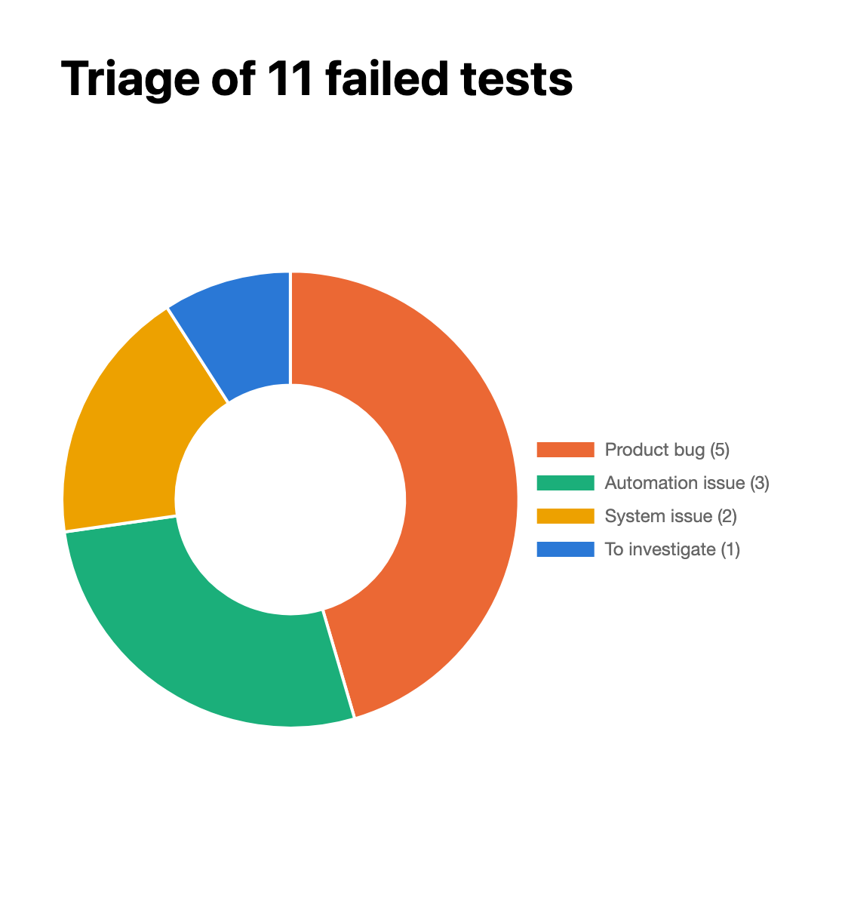
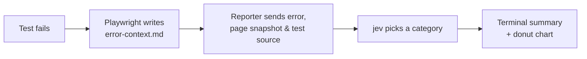

<div align="center">

# 🔎 Playwright AI Triage

**Every failed test gets a verdict: is the product broken, the test, or the environment?**




</div>

---

A custom Playwright reporter that sends each failed test to **jev** and sorts it into one of four categories. After the run you get a summary in the terminal and a donut chart of where your failures come from.

## ✨ What you get

In the terminal, after Playwright's own output:

```text
[triage]
  tests/triage-categories.spec.ts › cart total is the sum of the items → Product bug
  tests/triage-categories.spec.ts › settings can be saved → Automation issue
  tests/triage-categories.spec.ts › login page loads → System issue
  tests/triage-categories.spec.ts › dashboard shows the welcome message → To investigate
```

A chart is written to `test-results/triage-report.html`. Open it in a browser to see the image at the top of this page, built from your own run.

## 🏷️ The four categories

| Category | Meaning | Example |
|---|---|---|
| 🟠 **Product bug** | The application does the wrong thing | Cart shows € 20 for 2 × € 10 + € 5 |
| 🟢 **Automation issue** | The test is wrong, not the app | Button is called "Save changes", locator looks for "Save" |
| 🟡 **System issue** | The environment is down or unreachable | `ERR_CONNECTION_REFUSED`, a 502 page |
| 🔵 **To investigate** | Not enough information to decide | The page is empty, so there is nothing to compare against |

If the jev call itself fails, the test is listed as `triage failed` and shown in grey.

## 🧠 Why jev and not an LLM

The classification is done by **jev**, the [TypeSafe AI](https://typesafe.ai) model behind `client.systemOne()` (`jev-latest`, the SDK's default model). Instead of prompting a chat model and parsing free text, [`triage.ts`](triage.ts) asks one typed question with `choice()`:

```ts
category: choice("What type of bug is this?", {
    "Product bug": "The application behaves incorrectly: …",
    "Automation issue": "The test itself is wrong: …",
    // …
}),
```

The answer is always one of those four labels, and TypeScript knows that: the return type of `triage()` is the union of the category names. There is no prompt to write, no output to parse and no "almost a category" answer to handle.

## ⚙️ How it works



The key ingredient is the **page snapshot** that Playwright saves for each failure. It lets jev tell the cases apart:

- the element is on the page under another name → **automation issue**
- the element is missing → **product bug**
- the page shows an error → **system issue**

## 🚀 Quick start

You need your own OpenRouter API key first. Create one at [openrouter.ai/keys](https://openrouter.ai/keys) and put it in `.env` (third line below).

```sh
npm install
npx playwright install chromium
echo "OPENROUTER_API_KEY=sk-or-..." > .env
npm test
```

| Command | What it does |
|---|---|
| `npm test` | Run the suite with triage |
| `npm run typecheck` | Type-check the project with `tsc` |
| `npx playwright test tests/triage-categories.spec.ts` | Run only the demo tests |

> [!NOTE]
> The suite contains four **demo tests that fail on purpose**, one per category ([`tests/triage-categories.spec.ts`](tests/triage-categories.spec.ts)). Each run therefore makes four API calls. Delete them or skip them once you add your own tests.

## 🔑 API key

The key is read from `OPENROUTER_API_KEY`:

- **Locally:** put it in a `.env` file, which is loaded automatically and ignored by git.
- **In CI:** set it as a normal environment variable.

Without a key the tests still run. The reporter shows one warning and skips triage:

```text
[triage] OPENROUTER_API_KEY is not set, failed tests will not be triaged
```

## 🗂️ Project layout

```text
├── triage.ts                 jev call and the category definitions
├── triage-reporter.ts        Playwright reporter: collects failures, prints, writes the chart
├── triage-report.html        Chart template (open it directly for a preview with sample data)
├── playwright.config.ts      Registers the reporter next to the default "list" reporter
├── docs/                     Screenshot used in this README
└── tests/
    ├── triage-categories.spec.ts   Demo tests, one per category
    └── pages/                      Demo pages used by those tests
```

## 🎛️ Customising

- **Categories:** edit the descriptions in [`triage.ts`](triage.ts). The descriptions steer jev, so be specific about which errors belong where.
- **Chart:** edit [`triage-report.html`](triage-report.html). Keep the `const counts = /* COUNTS */ …;` line on one line, because the reporter replaces it with the real numbers.

## ⚠️ Good to know

- **Cost:** each failed test costs one jev call, so a broad outage with 200 failures means 200 calls.
- **Retries:** with `retries` enabled, every failed attempt is triaged and counted.
- **Chart.js:** the chart loads Chart.js from a CDN, so opening the report needs an internet connection.
- **Not a verdict:** the category is jev's judgement. Treat it as a first sort, not a final answer.
